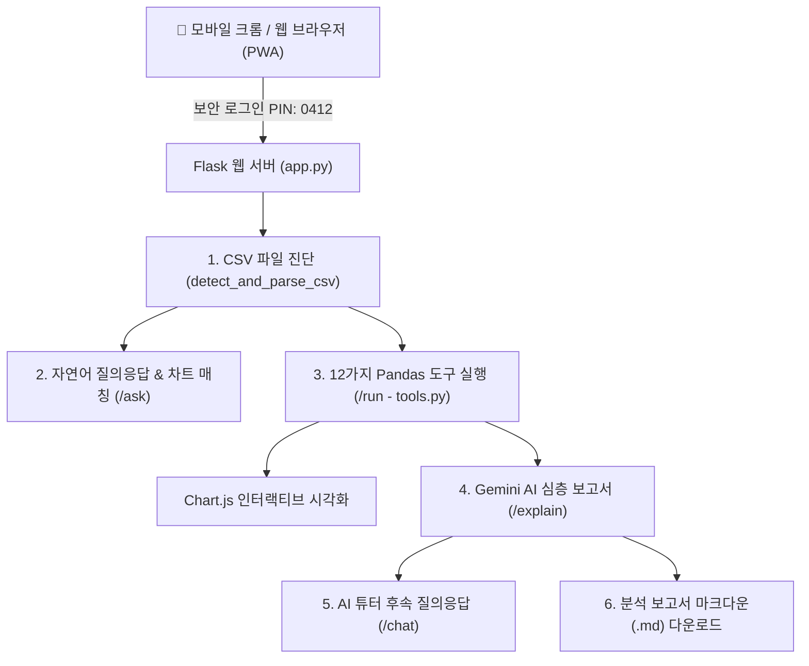

# 📊 AI Data Insight Builder

> **Python(Pandas)으로 계산하고 Gemini AI가 엄격한 통계 규칙으로 해석하는 교육용 데이터 분석 웹 애플리케이션**  
> 통계적 환각(Hallucination)과 왜곡을 방지하고, 자연어 질문 기반 시각화와 A/B 프롬프트 비교를 체험할 수 있는 풀스택 데이터 솔루션입니다.

[](https://www.python.org/)
[](https://flask.palletsprojects.com/)
[](https://pandas.pydata.org/)
[](https://ai.google.dev/)
[](https://developer.mozilla.org/ko/docs/Web/Progressive_web_apps)
[](https://vercel.com/)

---

## 🌟 핵심 특징 (Key Highlights)

### 1. 🔒 안전한 보안 인증 (PIN: `0412`)
- 웹앱 접속 시 세션 기반 비밀번호 인증 (`0412`) 적용
- 인증되지 않은 사용자의 API 직접 호출 차단 (`401 Unauthorized`)
- 상단 헤더에 즉시 잠글 수 있는 **`🔒 잠금/로그아웃`** 버튼 제공

### 2. 🔍 CSV 원본 데이터 자동 진단 (13개 핵심 항목)
- **인코딩 순차 자동 감지**: `utf-8-sig`, `utf-8`, `cp949`, `euc-kr` 순차 시도
- **헤더 위치 자동 계산**: World Bank 등 공공 통계의 상단 메타데이터 주석 행 자동 스킵
- **집계 그룹 행 자동 탐지**: World, OECD, Middle Income 등 국가가 아닌 40여 개 집계 행을 감지하여 평균 왜곡 방지
- **권장 기준연도 탐색**: 연도별 결측률을 분석하여 가장 신뢰도 높은 최근 연도(예: 2024년) 자동 추천

### 3. 💬 자연어 질의응답 & 맞춤형 차트 시각화 (`/ask`)
- 사용자가 일상 언어로 질문(예: *"2024년 세계 1~10등까지 순위국가와 대한민국을 함께 비교해줘"*)하면, AI가 분석 의도를 파악하고 적절한 Pandas 도구를 매칭
- **한국 하이라이트 기능**: 순위 비교 차트 생성 시 대한민국 막대만 고유 색상(보라색)으로 구별하여 가독성 극대화

### 4. 🧮 12가지 순수 Pandas 통계 분석 카탈로그 (`tools.py`)
| 도구 명칭 | 직관적 한글 기능 설명 |
| :--- | :--- |
| **`top_bottom_n`** | 국가별 순위 비교 분석 (상위·하위 N개국) |
| **`compare_one_vs_all`** | 대한민국 vs 전 세계 벤치마킹 비교 (평균/중앙값 대비) |
| **`trend_line`** | 주요국 연도별 시계열 추이 비교 (꺾은선 차트) |
| **`describe_numeric`** | 핵심 기술통계량 산출 (평균, 중앙값, 왜도, 사분위수) |
| **`group_summary`** | 대륙·지역 및 소득군별 평균 비교 |
| **`change_rate`** | 기간별 수치 변화량(%p) 및 성장률(%) 분석 |
| **`distribution`** | 수치 구간별 빈도 분포 분석 (히스토그램) |
| **`correlation_scatter`** | 두 지표 간 상관분석 및 산점도 |
| **`quality_report`** | 데이터 품질 진단 리포트 (열별 결측치·유효 비율) |
| **`detect_aggregates`** | 대륙·경제권 집계 그룹 상세 탐지 |
| **`year_coverage`** | 연도별 충실도 분석 (기준시점 선정 보조) |
| **`reshape_wide_to_long`** | 연도 열 행으로 접기 (타이드 포맷 변환) |

### 5. 🤖 프롬프트 A/B 비교 기반 AI 인사이트 해석 (`/explain`)
- **🌟 모드 B (정식 보고서)**: 
  - 엄격한 8대 규칙(Pandas 실제 계산 수치만을 근거로 인용, 상상 수치 금지, 집계 제외 행 명시 등) 적용
  - 사용자가 상단에서 물어보았던 **원래 자연어 질문과 100% 연계**되어 맞춤형 답변 제공
- **⚠️ 모드 A (비교용 보고서)**: 
  - 수치 계산 결과를 주지 않고 데이터 구조만 보고 작성하게 하여, 환각(Hallucination) 위험을 학습자가 직접 체험

### 6. 💬 대화형 AI 튜터 후속 Q&A (`/chat`)
- 생성된 보고서를 바탕으로 궁금한 점을 채팅창에서 질문 가능
- **말풍선 추천 질문 칩**: *"중학생도 이해할 수 있게 쉽게 설명해줘"*, *"초보자가 주의해야 할 해석상 함정은?"* 등을 클릭 한 번으로 질의

### 7. 📑 분석 보고서 마크다운(`.md`) 다운로드
- 생성 일시, 보고서 모드, 연계된 사용자 질문, 사용 도구, 필터링 행 수, AI 종합 보고서 및 후속 Q&A 대화 이력 전체를 `.md` 문서로 즉시 저장

### 8. 📱 스마트폰 크롬 PWA 앱 다운로드 지원
- **홈 화면에 앱 설치**: 스마트폰 크롬 브라우저에서 '앱 설치' 버튼 또는 메뉴를 통해 독립 앱으로 다운로드 가능
- **전용 고화질 아이콘**: 모바일 홈 화면용 192x192, 512x512, Maskable 적응형 아이콘 탑재
- **모바일 반응형 최적화**: 폰트 16px 입력창(모바일 자동 줌인 방지), 터치 친화적 패딩, 좌우 스크롤 수치 표

---

## 🏗️ 시스템 아키텍처



---

## 📁 디렉터리 구조

```text
data-insight-builder/
├── api/
│   └── index.py            # Vercel 서버리스 진입점
├── data/                   # 샘플 공공데이터 (World Bank 통계 CSV)
├── static/
│   ├── icons/              # PWA 및 앱 고화질 아이콘 (192, 512, favicon 등)
│   ├── app.js              # 프론트엔드 비즈니스 로직 및 PWA 서비스워커 등록
│   ├── manifest.json       # PWA 웹앱 매니페스트
│   ├── style.css           # 모바일 최적화 반응형 스타일시트
│   └── sw.js               # 오프라인 및 캐싱 지원 서비스 워커
├── templates/
│   ├── index.html          # 메인 분석 대시보드 화면
│   └── login.html          # 보안 로그인 (PIN 0412) 화면
├── .env.example            # 환경변수 템플릿
├── .gitignore              # Git 제외 설정 (API Key 및 캐시 보호)
├── app.py                  # Flask 메인 애플리케이션 & REST API
├── generate_icons.py       # PWA 고화질 아이콘 생성 스크립트
├── requirements.txt        # 파이썬 의존성 패키지 목록
├── test_e2e.py             # 전체 파이프라인 E2E 통합 테스트
└── vercel.json             # Vercel 배포 라우팅 설정
```

---

## 🚀 빠른 시작 가이드 (Local Run)

### 1. 저장소 클론
```bash
git clone https://github.com/sgmkug3-glitch/data-insight-builder.git
cd data-insight-builder
```

### 2. 가상환경 생성 및 패키지 설치
```bash
python -m venv .venv

# Windows
.venv\Scripts\activate

# Mac/Linux
source .venv/bin/activate

pip install -r requirements.txt
```

### 3. 환경 변수 설정
프로젝트 루트에 `.env` 파일을 생성하고 아래 내용을 입력합니다:
```env
GEMINI_API_KEY=your_actual_gemini_api_key_here
GEMINI_MODEL=gemini-2.5-flash
APP_PASSWORD=0412
SECRET_KEY=data-insight-builder-secret-key-2026
MAX_UPLOAD_MB=10
FLASK_DEBUG=true
PORT=5000
```
> [!NOTE]  
> Google Gemini API 키는 [Google AI Studio](https://aistudio.google.com/)에서 무료로 발급받으실 수 있습니다.

### 4. 로컬 웹 서버 실행
```bash
python app.py
```
브라우저에서 `http://127.0.0.1:5000`에 접속한 후, 비밀번호 **`0412`**를 입력하세요.

### 5. 통합 테스트 실행
```bash
python test_e2e.py
```

---

## ☁️ Vercel 배포 가이드

본 프로젝트는 Vercel 배포를 위한 `vercel.json` 및 `api/index.py` 구성이 완료되어 있습니다.

1. [Vercel](https://vercel.com/) 대시보드에서 `sgmkug3-glitch/data-insight-builder` 저장소를 Import합니다.
2. **Environment Variables**에 다음 항목을 등록합니다:
   - `GEMINI_API_KEY`: 발급받은 Gemini API 키
   - `GEMINI_MODEL`: `gemini-2.5-flash`
   - `APP_PASSWORD`: `0412`
   - `SECRET_KEY`: 임의의 긴 보안 문자열
3. **Deploy**를 클릭하면 수 초 내에 전 세계 어디서든 접속 가능한 웹앱이 배포됩니다.

---

## 🛡️ 데이터 보안 및 프라이버시

- **무저장 메모리 원칙**: 업로드된 CSV 데이터셋은 서버 디스크에 저장되지 않으며, 서버 메모리(RAM)에 1세트만 임시 보관됩니다.
- **키 보호**: API Key는 클라이언트 브라우저로 전송되지 않으며, 서버 백엔드 환경변수를 통해서만 안전하게 호출됩니다.
- **PIN 세션 잠금**: 비인가된 사용자의 접속을 막기 위한 접속 비밀번호 보호 체계를 갖추고 있습니다.

---

## 📄 라이선스 (License)

This project is licensed under the MIT License.
